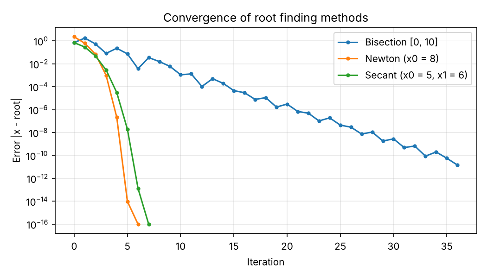
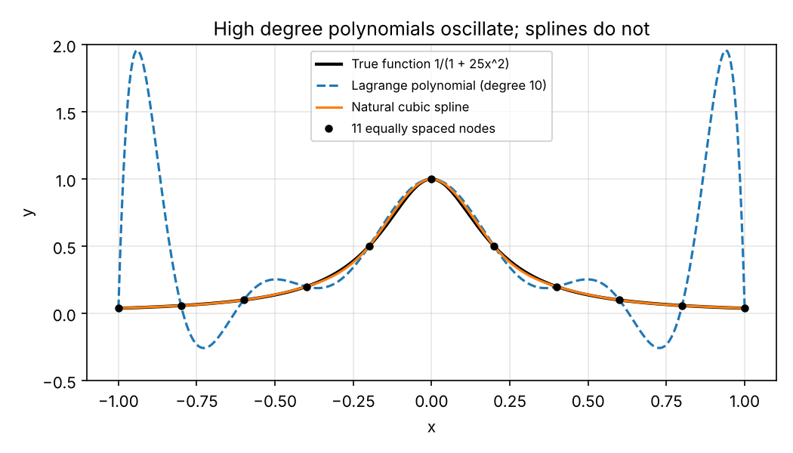
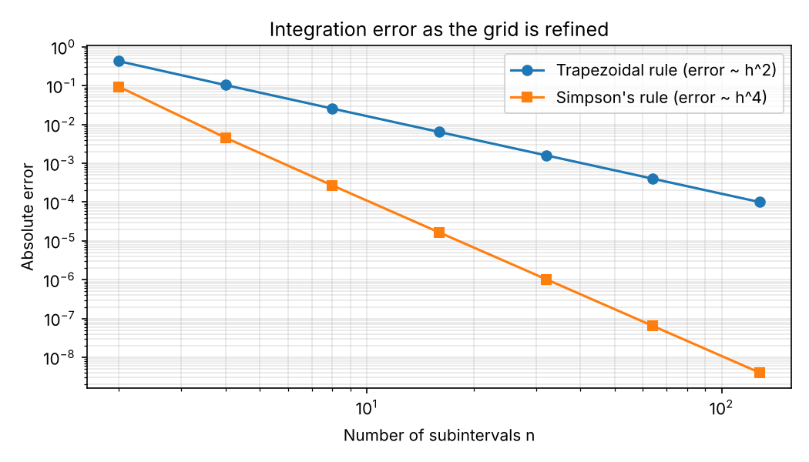

# Numerical Methods in Python


Root finding, linear system solvers, interpolation, and numerical integration written from scratch in Python. Every method is checked against NumPy and SciPy by an automated test suite that runs on GitHub Actions with every push.

This started as my coursework for Numerical Analysis (Math 355) at Capitol Technology University. Most of the original solutions called library functions such as `np.linalg.solve` and `scipy.optimize.newton`. This version implements the algorithms myself and proves they give the same answers.

**Skills shown:** Python, NumPy, SciPy, Matplotlib, algorithm implementation, automated testing with pytest, continuous integration with GitHub Actions, and technical documentation.

## What's implemented

| Area | Methods | Checked against |
|---|---|---|
| Root finding | Bisection, Newton's method, secant method | `scipy.optimize.newton`, `brentq` |
| Linear systems | Gaussian elimination with partial pivoting, LU decomposition (PA = LU), Cholesky, matrix inverse | `np.linalg.solve`, `cholesky`, `inv` |
| Interpolation and fitting | Lagrange polynomial, natural cubic spline, least squares polynomial fit | `scipy.interpolate.CubicSpline`, `np.polyfit` |
| Integration | Composite trapezoidal rule, composite Simpson's rule | `scipy.integrate.quad` and exact answers |

## Results

Running `python demo.py` solves problems from the course and saves the plots below.

### Root finding: how fast each method converges

On the final exam polynomial f(x) = x³ + 12x² − 100x − 6, all three methods find the same root, x = 5.7068936974. Newton's method gets there in 6 steps and bisection takes 37, because Newton's error roughly squares each step while bisection only halves it.



### Linear systems: a zero pivot

The midterm system below has a 0 in the top left corner, so plain Gaussian elimination would divide by zero. Partial pivoting swaps rows first, and the solver returns x = (2, −1, 0, 1) with zero residual.

```
 0x₁ + 2x₂ + 5x₃ −  x₄ = −3
 2x₁ +  x₂ + 3x₃       =  3
−2x₁ −  x₂ + 3x₃ +  x₄ = −2
 3x₁ + 3x₂ −  x₃ + 2x₄ =  5
```

### Interpolation: why splines beat high degree polynomials

Fitting 11 evenly spaced points of Runge's function with a single degree 10 polynomial causes wild swings near the edges, with a maximum error of 1.916. A natural cubic spline through the same points stays within 0.022.



### Integration: error as the grid is refined

Doubling the number of subintervals cuts the trapezoidal error by about 4 times and Simpson's error by about 16 times. These match their theoretical orders of h² and h⁴.



## Project structure

```
numerical_methods/        the library
  roots.py                bisection, Newton, secant
  linear_systems.py       Gaussian elimination, LU, Cholesky, inverse
  interpolation.py        Lagrange, natural cubic spline, least squares
  integration.py          trapezoidal and Simpson's rules
tests/                    17 pytest tests comparing results with NumPy and SciPy
demo.py                   runs every method and saves the plots in docs/images
.github/workflows/        GitHub Actions workflow that runs the tests on every push
coursework/               my original homework, midterm, and final exam solutions
```

## How to run it

```bash
pip install -r requirements.txt
pytest -v          # run the 17 tests
python demo.py     # print results and regenerate the plots
```

## Author

Jubril Hall-Robinson, B.S. Computer Engineering, Capitol Technology University
[jubrilhall-robinsonportfolio.dev](https://jubrilhall-robinsonportfolio.dev) | [LinkedIn](https://www.linkedin.com/in/jubrilhallrobinson)
